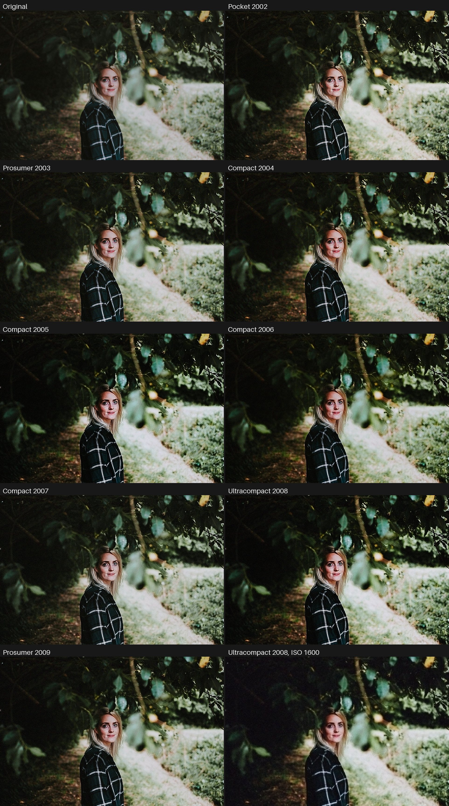
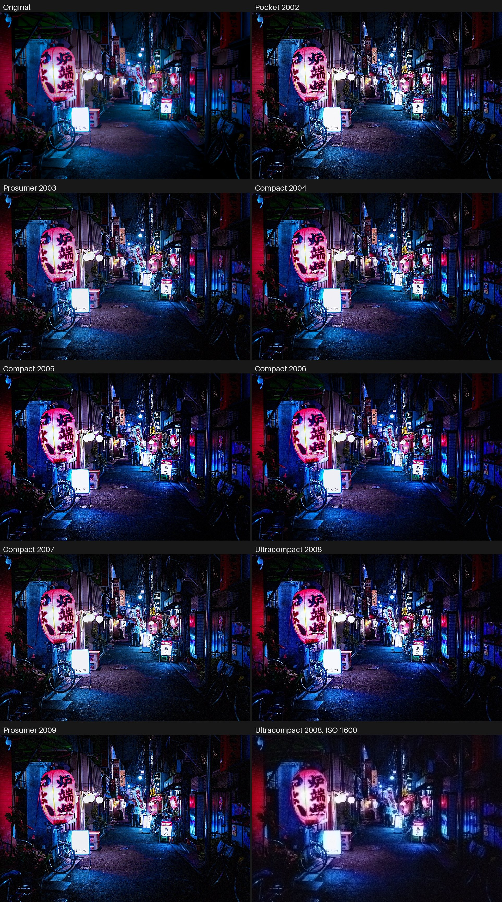
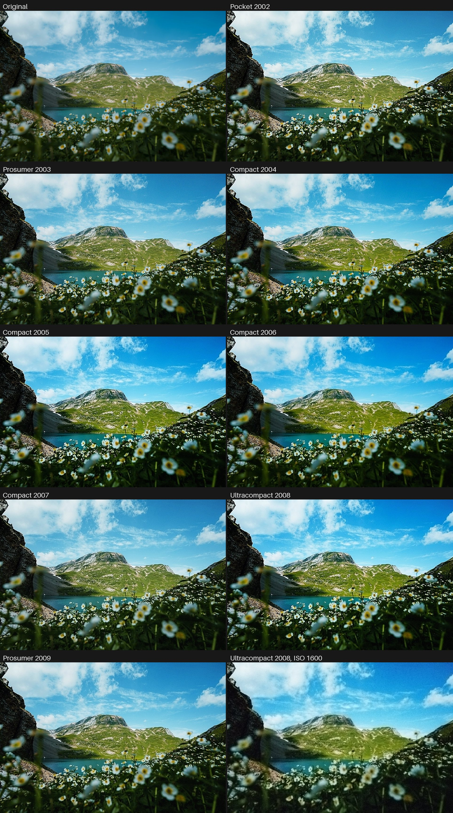
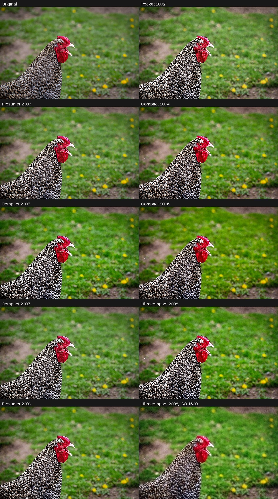
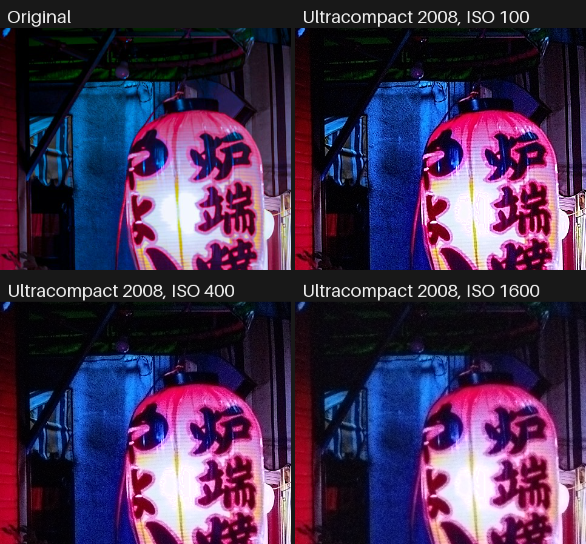

# Marcs Digicam Emulator (v0.1.3)

The look of 2000s CCD compact cameras for **PhotoCraft**, as one WebAssembly filter plug-in
(plug-in ABI v1): eight cameras from 2002 to 2009, each a modelled CCD sensor (primary RGB or
complementary Ye/Cy/Mg/G filters) behind the camera's processing – hard digital highlights,
sensor colour, noise by ISO, noise reduction, oversharpening, blooming and purple fringing.
Companion to [Marcs Film Emulator](https://github.com/marc-gronenberg/Marcs-Film-Emulator).

## Download

**[⬇ marcs-digicam-emulator.wasm](https://github.com/marc-gronenberg/marcs-digicam-emulator/releases/latest/download/marcs-digicam-emulator.wasm)**
(7 MB) – the whole plug-in. In PhotoCraft: **Filter › Plug-ins › Install Plug-in…**, then
**Filter › Plug-ins › Marcs Digicam Emulator…**.

## Comparisons

Default settings (ISO 100, everything at 100), rendered with the plug-in itself; the last image of
each set is the smallest-pixel camera at ISO 1600.

At 1:1 – oversharpening halos around the lettering, purple fringing at the blown lantern, the
noise and the noise reduction's "watercolour" growing with ISO:

Photos: [Mitchell Orr](https://unsplash.com/@mitchorr), [Alex Knight](https://unsplash.com/@agk42) and
[Seb Zurcher](https://unsplash.com/@seb_zr) on [Unsplash](https://unsplash.com/license); rooster by
dendoktoor on [Pixabay](https://pixabay.com/service/license-summary/).

## The cameras

| Dropdown | Sensor (modelled) | Pixel | Highlight headroom | Character |
|---|---|---|---|---|
| Pocket 2002 | complementary CMYG, 2 MP 1/2.7" | 3.4 µm | 2.6 stops | warm, soft colour, strong blooming, crunchy |
| Prosumer 2003 | complementary CMYG, 5 MP 2/3" | 3.4 µm | 3.0 stops | neutral, gentle, the CMYG palette |
| Compact 2004 | primary RGB (early filters), 5 MP 1/1.8" | 2.7 µm | 3.0 stops | warm skin, rich reds |
| Compact 2005 | primary RGB, 7 MP 1/1.8" | 2.3 µm | 2.8 stops | cool, punchy, magenta lean, hard sharpening |
| Compact 2006 | primary RGB, 6 MP 1/1.7" | 2.8 µm | 3.3 stops | vivid greens and blues |
| Compact 2007 | primary RGB, 8 MP 1/2.5" | 2.2 µm | 2.9 stops | neutral, a touch yellow-green |
| Ultracompact 2008 | primary RGB (late filters), 10 MP 1/2.3" | 1.75 µm | 2.7 stops | contrasty, noisy, heavy noise reduction, strong fringing |
| Prosumer 2009 | primary RGB (late filters), 10 MP 1/1.7" | 2.0 µm | 3.2 stops | clean, restrained |

The names are neutral (era and class); the characters are those the makers of the time were known
for, not any single model.

## Parameters

| Parameter | Range | Default | What it does |
|---|---|---|---|
| Camera | the eight above | Compact 2004 | The camera |
| Input Space | sRGB / Display P3 / Adobe RGB | sRGB | The document's colour space |
| Exposure | −2 … +2 EV | 0 | Exposure compensation *into* the camera: more blows highlights the digital way |
| ISO | 100 … 1600 | 100 | Sensor gain: more noise, and more noise reduction to fight it |
| Strength | 0 … 100 | 100 | Mix with the original in linear light; 0 returns it unchanged |
| Noise | 0 … 200 % | 100 | Sensor noise relative to the camera's |
| Noise Reduction | 0 … 200 % | 100 | The camera's noise reduction (chroma blur, luma "watercolour" at high ISO) |
| Sharpening | 0 … 200 % | 100 | The camera's unsharp mask, halos included |
| Blooming | 0 … 200 % | 100 | Charge spilling up and down the column from blown highlights |
| Purple Fringing | 0 … 200 % | 100 | Violet edges around blown highlights |
| Seed | 0 … 9999 | 1 | Noise pattern |

## How it works

**Modelled, not measured.** The CCD datasheets of these cameras' sensors (Sony ICX series) are no
longer published, so the sensors are modelled from the physics of their parts
(`model/digicam_model.py`): pigment filters for primary RGB (blue and green as broad bands, red as
an edge; early filters broader and more overlapping than late ones), dye filters for complementary
CMYG (yellow and cyan as edges, magenta as a notch, plus green), silicon quantum efficiency of a
front-illuminated interline CCD (low in the blue, highest in the yellow-green), and the IR-cut glass.

Per camera the model then does what the camera did, and bakes it into a 37³ LUT over 13 stops of
scene exposure:

1. the scene as a smooth spectrum under daylight (as in Marcs Film Emulator), its raw signal in each
   filter channel;
2. exposure so that 18 % grey sits *headroom* stops below full well in the most sensitive channel;
3. **clipping at full well per channel**, then white balance on grey and a clip of every channel at
   the least amplified one's saturation – the hard digital highlight: a channel that clips first
   shifts the hue of what is brighter, a fully blown highlight is white;
4. a **colour matrix fitted by least squares** from the sensor to sRGB (3×3, or 3×4 for CMYG),
   keeping white white. Where the modelled sensitivities are not a linear mix of the eye's, the fit
   leaves hue errors: the sensor's own colour. The CMYG matrices are strong (coefficients over 2),
   which is why those cameras' noise is so colourful;
5. a tone curve with a short knee that ends exactly at clip, a little black crush and contrast,
   and the maker's style in Oklab (saturation, a few hue twists of memory colours: skin, reds,
   greens, sky). **These style values are assumptions**, set by analogy, not measured.

In the plug-in, before the LUT, **sensor noise** is added in the raw channels – shot noise from the
pixel's full well (about 2000 e⁻ per µm²), read noise that shrinks with gain – and carried into the
scene through the camera's white balance and matrix, so it clips, colours and tones the way the
camera's did. A channel at the top of an 8- or 16-bit document was already clipped in the source,
so it counts as one stop over full well (at Exposure 0) and blooms and fringes like a blown
highlight; 32-bit documents carry the real brightness. After the LUT come the spatial stages, on
the encoded image as in the cameras:
blooming (an exponential spill up and down the column, longer the more the highlight is blown),
purple fringing (a violet halo on the dark side of blown edges), noise reduction (chroma kept at
half resolution, as the cameras' 4:2:0 JPEGs stored it, and blurred there; luma softened at high
ISO) and sharpening (unsharp mask on luma with a small threshold).

## Limits

- The sensors are models, not measurements; the makers' processing is unpublished and modelled.
- **No full-height smear.** A real CCD smears a bright light into a vertical line over the whole
  frame; a PhotoCraft plug-in sees the image in bands of 256 rows, so only the local blooming
  (up to about 20 px) is possible.
- Noise is per document pixel: it is the camera's noise when the document is at the camera's
  resolution, finer when larger, coarser when smaller.
- Noise added in the shadows is clipped at black like in the cameras, which lifts deep shadows a
  little at ISO 800 and 1600.
- No JPEG artefacts, resolution loss or date stamp (yet).
- Speed: every pixel takes the full path (noise makes each one different, so a colour cache like
  the film emulator's misses too often: tried, 30–50 % slower), about 37 s for 24 MP on two
  threads in the test host, about 42 s when many highlights are blown and about 50 s with a
  Strength below 100 or a Display P3 / Adobe RGB document; PhotoCraft runs four bands at once.
- RGB and Grayscale only.

## Layout

| Path | What |
|---|---|
| `plugin/` | the plug-in's Rust source (`no_std`, no imports); `src/cameras.rs` is generated |
| `common/` | ABI glue, parameter reader, table lookups, blurs |
| `model/digicam_model.py` | the camera model → `lut/<camera>.lut` and `plugin/src/cameras.rs` |
| `model/make_tables.py` | decode tables, Adobe RGB tables, the sensor noise texture |
| `harness/` | test host mirroring PhotoCraft's plug-in host; `cargo test --release` there checks the plug-in in `dist/` (Strength 0 is the identity for every input space, depth and grey, every camera at every depth and ISO, primaries keep their hue in every input space, monotonic grey without noise, noise growing with ISO, a highlight clipped in the document blooms vertically and fringes purple) |
| `build.sh` | build and test (`--data` re-runs the model first); `common/` has a test of its own (the radius-1 blur against the general one) |

## Licence

MIT (see `LICENSE`). The photos in `docs/` are not under the MIT licence: they are used under the
Unsplash License and the Pixabay Content License (photographers credited under Comparisons).
